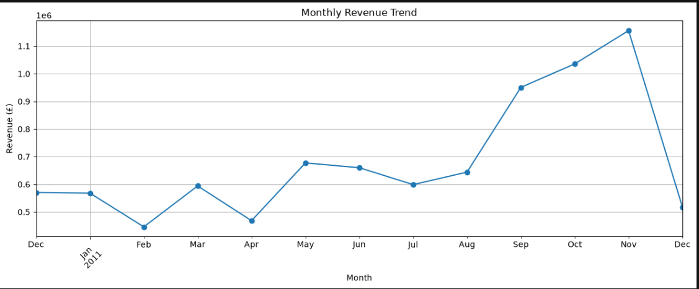
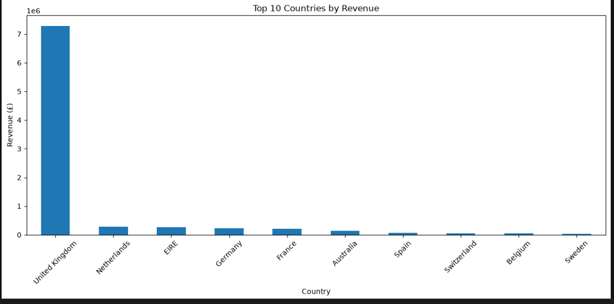
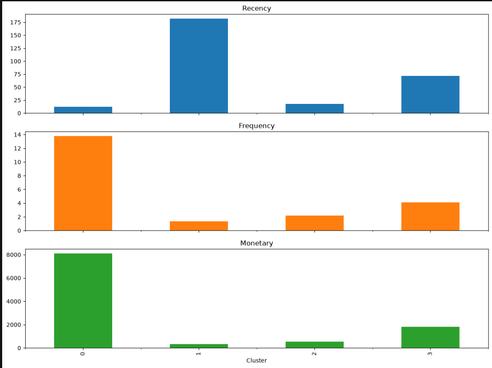

# Customer Segmentation Analysis

## Project Overview

This project focuses on analyzing customer purchasing behavior using the **Online Retail Dataset**. The objective is to identify different customer segments based on their purchasing patterns and understand customer retention.

The project uses Exploratory Data Analysis (EDA), RFM (Recency, Frequency, Monetary) Analysis, K-Means Clustering, and Cohort Analysis to derive meaningful business insights.

## Objectives

- Analyze customer purchasing behavior.
- Identify sales and revenue trends.
- Segment customers based on their purchasing patterns.
- Identify high-value and at-risk customers.
- Analyze customer retention over time.

## Dataset

**Dataset:** Online Retail Dataset

The dataset contains transactions from a UK-based online retail store between December 2010 and December 2011.

Important columns include:

- `InvoiceNo` – Transaction invoice number.
- `StockCode` – Product code.
- `Description` – Product description.
- `Quantity` – Number of products purchased.
- `InvoiceDate` – Date and time of transaction.
- `UnitPrice` – Price per product.
- `CustomerID` – Unique customer identifier.
- `Country` – Customer's country.

## Technologies Used

- Python
- Pandas
- NumPy
- Matplotlib
- Seaborn
- Scikit-learn
- Jupyter Notebook

## Project Workflow

### 1. Data Cleaning and Preprocessing

- Checked for missing values.
- Removed records with missing CustomerID.
- Identified and removed duplicate records.
- Removed cancelled transactions and invalid quantity and price records.
- Converted InvoiceDate into datetime format.
- Created a Revenue column using Quantity × UnitPrice.

After preprocessing, the dataset contained **392,692 transaction records** and 8 columns.

### 2. Exploratory Data Analysis (EDA)

Performed exploratory analysis to understand customer purchasing behavior.

Analysis included:

- Monthly revenue trends.
- Revenue distribution across countries.
- Recency, Frequency and Monetary distributions.

**Key Observation:** The United Kingdom contributed the highest revenue among all countries in the dataset.

### 3. RFM Analysis

RFM analysis was performed to evaluate customers using three metrics:

- **Recency:** Number of days since the customer's last purchase.
- **Frequency:** Total number of unique invoices associated with the customer.
- **Monetary:** Total amount spent by the customer.

The analysis identified **4,338 unique customers**.

### 4. Data Standardization

Applied log transformation to reduce skewness in the RFM variables and StandardScaler to standardize the features before clustering.

### 5. K-Means Customer Segmentation

Used the Elbow Method to determine a suitable number of clusters.

Selected **K = 4** and applied the K-Means clustering algorithm.

The customers were divided into four segments:

| Cluster | Customer Segment | Number of Customers |
|---|---|---:|
| 0 | High-value loyal customers | 713 |
| 1 | At-risk / inactive customers | 1,622 |
| 2 | Recent low-spending customers | 837 |
| 3 | Regular customers | 1,166 |

The segments were interpreted using the average Recency, Frequency and Monetary values of each cluster.

### 6. Cohort Analysis

Performed cohort analysis to understand customer retention behavior over time.

Steps involved:

- Grouped customers based on their first purchase month.
- Calculated the cohort index.
- Created a cohort table using unique customer counts.
- Calculated monthly customer retention percentages.
- Visualized retention using a heatmap.

This analysis helped identify how repeat purchasing behavior changed across different customer cohorts.

## Key Findings

- Identified 4,338 unique customers through RFM analysis.
- Divided customers into four distinct segments using K-Means.
- Identified 713 high-value loyal customers.
- Found that 1,622 customers belonged to the at-risk / inactive segment.
- Identified the United Kingdom as the highest revenue-generating country.
- Used cohort analysis to examine customer retention patterns over time.

## Project Structure

```text
Customer-Segmentation-Analysis/
│
├── README.md
├── Customer_Segmentation.ipynb
├── Customer_Segmentation_Results.csv
│
├── dataset/
│   └── Online Retail.xlsx
│
└── images/
    ├── monthly_revenue.png
    ├── country_revenue.png
    ├── customer_distribution.png
    ├── rfm_clusters.png
    ├── cohort_heatmap.png
    └── elbow_method.png
```

## Visualizations

### Monthly Revenue Trend



### Revenue by Country



### Elbow Method


### Customer Distribution Across Clusters


### RFM Cluster Analysis



### Cohort Retention Heatmap


## How to Run the Project

1. Clone the repository:

```bash
git clone YOUR_GITHUB_REPOSITORY_URL
```

2. Navigate to the project directory:

```bash
cd Customer-Segmentation-Analysis
```

3. Install the required libraries:

```bash
pip install pandas numpy matplotlib seaborn scikit-learn openpyxl jupyter
```

4. Launch Jupyter Notebook:

```bash
jupyter notebook
```

5. Open `Customer_Segmentation.ipynb` and run the cells sequentially.

## Conclusion

This project demonstrates how customer transaction data can be analyzed to identify meaningful customer segments and understand purchasing behavior.

By combining RFM analysis, K-Means clustering and Cohort Analysis, the project provides insights into customer value, purchasing patterns and retention behavior.

These insights can help businesses make better decisions regarding customer engagement and retention strategies.
